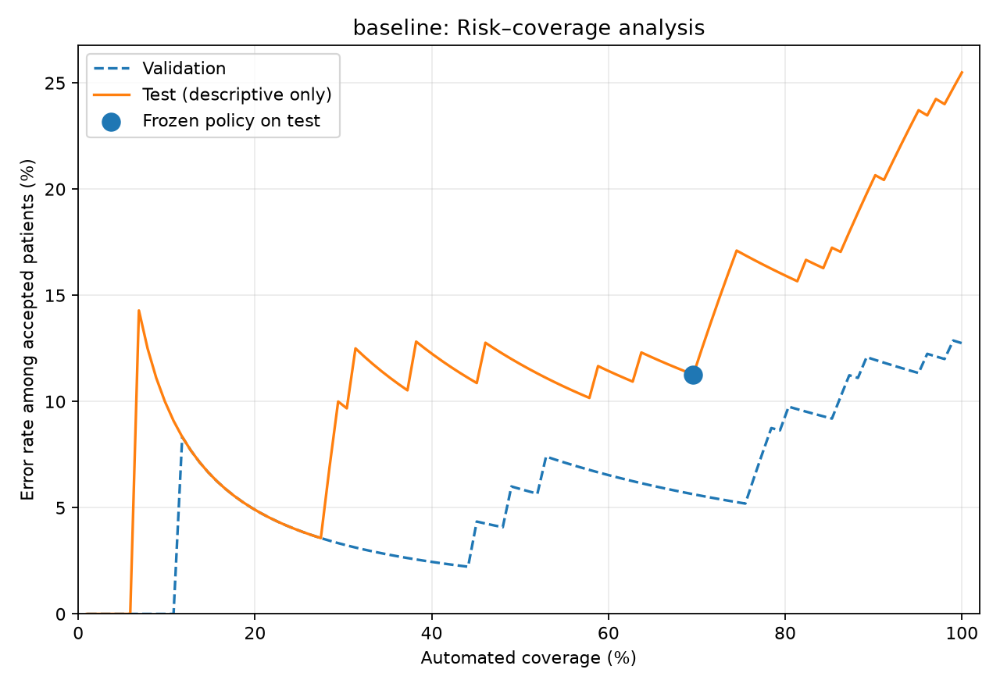
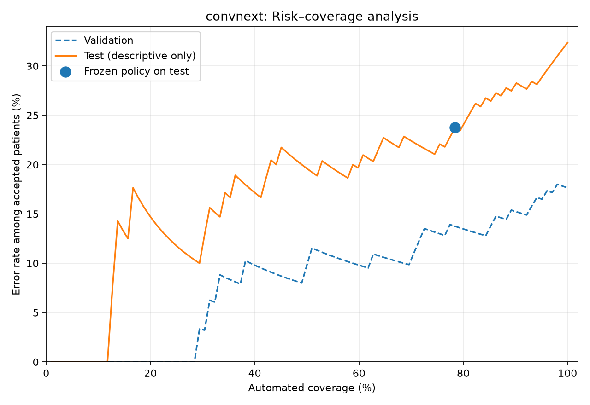
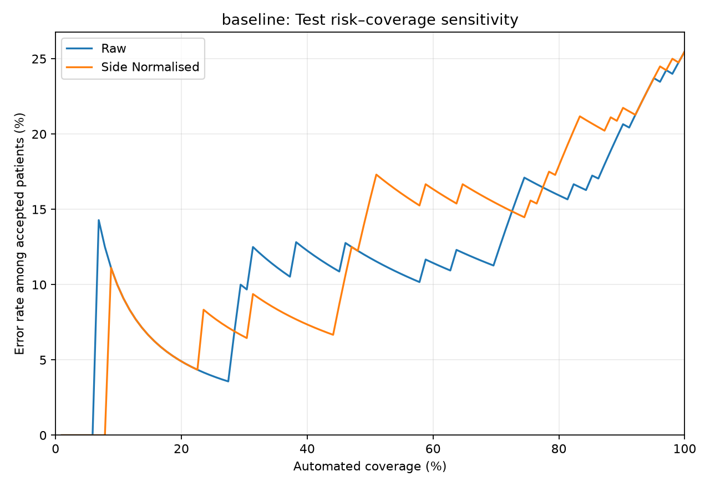
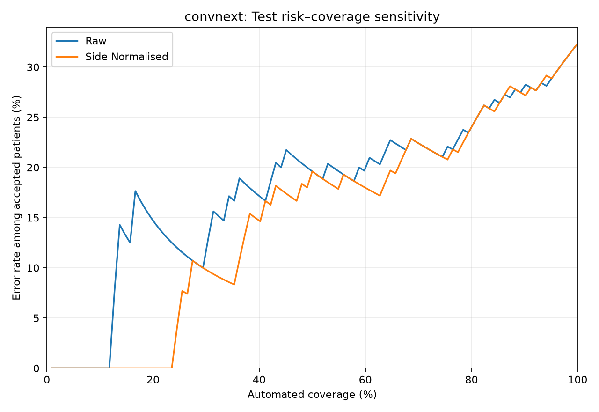

# Alzheimer's Disease Classification Using ConvNeXt

**Author:** Edan Zhao 47996386

**Course:** COMP3710 — Pattern Recognition

**Difficulty:** Hard

**Framework:** PyTorch

**Dataset:** Alzheimer's Disease Neuroimaging Initiative (ADNI)

**Status:** Experimental evaluation completed

## 1. Project Overview

This project investigates whether ConvNeXt-Tiny offers meaningful improvements over a smaller convolutional neural network (CNN) for binary classification of Alzheimer's Disease (AD) and cognitively normal (NC) subjects using structural brain MRI slices.

The investigation considers not only classification accuracy but also patient-level generalisation, sensitivity, specificity, prediction confidence, probability quality and computational efficiency.

Both architectures were trained from scratch and evaluated using identical patient-independent training, validation and held-out test partitions. Validation data was used for checkpoint selection and patient-level classification threshold optimisation. The initial held-out test evaluation was performed after model and classification-threshold selection. Subsequent reject-option, ranking-sensitivity and bootstrap analyses reused the saved test predictions for retrospective research, without retraining or selecting operating thresholds using test labels.

## 2. Research Question

**Does ConvNeXt provide more accurate and reliable predictions than a standard CNN baseline, particularly when prediction confidence does not reflect actual correctness?**

The investigation addresses four related questions:

1. Does ConvNeXt improve classification performance on unseen patients?
2. How do the architectures differ in sensitivity, specificity and confidence quality?
3. Does validation-based threshold optimisation generalise to the held-out test set?
4. Are any performance gains justified by ConvNeXt's additional computational complexity?
5. Can confidence-based rejection improve classification reliability, and how do the resulting accuracy–coverage trade-offs differ between the two architectures?

### 2.1 Mandatory Feasibility Review


#### 1. User Need, Scope & Acceptance Criteria

**Intended user:** An ML engineer evaluating a research prototype for Alzheimer's disease (AD) versus normal control (NC) classification from 2D ADNI MRI slices.

The central dilemma is whether a more complex ConvNeXt model delivers useful improvements over a simple CNN without misleading confidence, patient leakage, or excessive compute.

**This is not a clinical diagnostic system.**

**Acceptance criteria:**

1. Use patient-disjoint training, validation and test sets; verify zero patient overlap.
2. Compare ConvNeXt-Tiny against an implemented CNN baseline on identical splits using accuracy, F1 and AUROC.
3. Assess probability calibration and inspect at least 3–5 misclassified or ambiguous cases.
4. Measure parameter count, peak GPU VRAM and inference latency; target a single-GPU training run and report actual resource use.

#### 2. Model Choice & Course Concepts

**Dataset:** ADNI AD/NC MRI JPEG slices on Rangpur. Grayscale slices are resized to 224 × 224 pixels and replicated to three channels. Labels are NC = 0 and AD = 1.

Stratified patient-level splitting produces 70%/15%/15% train/validation/test patient partitions (seed 42).

**Models:**

- **Baseline CNN:** Four-block convolutional neural network with 1,173,730 parameters.
- **ConvNeXt-Tiny:** Hard-difficulty architecture with 27,821,666 parameters.

Both architectures produce two logits for cross-entropy classification. ConvNeXt is the selected Hard architecture.

**Relevant course concepts:**

- Hierarchical convolutional feature extraction
- Transfer learning (if permitted and weights available)
- Regularisation and generalisation
- Class imbalance
- Calibrated probabilistic predictions

#### 3. Preliminary Feasibility Evidence

**Dataset audit:**

The dataset contains 30,520 MRI images from 680 unique patients.

The supplied training and testing folders contain **216 patients appearing in both partitions**, risking inflated performance estimates.

Repartitioning by patient produces:

| Partition | MRI images | Patients |
|---|---:|---:|
| Training | 21,640 | 476 |
| Validation | 4,280 | 102 |
| Test | 4,600 | 102 |
| **Total** | **30,520** | **680** |

Patient sets are mutually exclusive, preventing patient overlap across partitions.

**Preliminary smoke tests:**

- The DataLoader successfully returns tensors of shape `[4, 3, 224, 224]`.
- Both architectures completed CPU forward passes with output shape `[2, 2]`.
- Both models produced finite logits.

At the time of this feasibility review, no training results or accuracy claims were available.

#### 4. Risks, Compute Budget & Fallback

**Identified risks:**

- GPU queue and driver compatibility
- ImageNet weight availability
- Overfitting on correlated MRI slices
- Class and patient imbalance
- Misleading slice-level evaluation metrics
- Poor probability calibration

**Compute budget:**

Use a single GPU allocation on the Rangpur cluster through Slurm when available.

The initial plan was to:

1. Begin with a short pilot training run.
2. Record actual peak GPU VRAM, epoch duration and inference latency.
3. Limit training epochs using validation-based early stopping.

At the time of the feasibility review, the full training runtime had not yet been measured.

**Planned next experiment:**

1. Implement the training pipeline.
2. Verify that training loss decreases on a small subset.
3. Train the CNN baseline before ConvNeXt using fixed patient-independent splits.
4. Evaluate the held-out test data only after model selection.
5. Aggregate predictions by scan or patient where feasible.

**Fallback strategy:**

If computational or implementation constraints arise:

- Reduce the training batch size.
- Use mixed precision on compatible GPUs.
- Freeze the ConvNeXt backbone or shorten training.
- Retain the working baseline and transparently document any incomplete experiments.

## 3. Dataset and Data Integrity

### 3.1 Dataset

The project uses the ADNI structural brain MRI dataset provided through the UQ Rangpur computing cluster.

Dataset location:

`/home/groups/comp3710/ADNI`

The provided data includes MRI image slices, metadata and AD/NC classification labels.

### 3.2 Patient-level leakage investigation

An initial audit identified 1,076 unique training scans and 450 unique testing scans in the supplied partitions.

Although no scan identifiers overlapped, **216 patient identifiers appeared in both partitions**.

This is important because MRI slices and scans from the same patient may share anatomical characteristics. A model evaluated on images from previously encountered patients may appear to generalise better than it actually does.

To prevent this form of leakage, the project generated new partitions using patient identifiers as the grouping unit. Each patient was assigned exclusively to training, validation or testing.

### 3.3 Final dataset partition

| Partition | Patients | MRI slices | NC slices | AD slices |
|---|---:|---:|---:|---:|
| Training | 476 | 21,640 | 11,380 | 10,260 |
| Validation | 102 | 4,280 | 2,100 | 2,180 |
| Test | 102 | 4,600 | 2,180 | 2,420 |
| **Total** | **680** | **30,520** | **15,660** | **14,860** |

The split was generated with random seed 42 and stored locally in `splits.json`.

The patient-independent split is generated locally from the authorised ADNI dataset using the data preparation functionality in `dataset.py`. The procedure assigns each patient exclusively to one partition and uses random seed 42 for reproducibility. Once generated, `splits.json` records the train, validation and test assignments so that subsequent training and evaluation runs use consistent partitions.

The split manifest is excluded from version control because it contains patient identifiers and image paths. Reproducing the experiment therefore requires authorised access to the original ADNI dataset and regeneration of the split manifest.

The validation and test partitions each contain 69 NC patients and 33 AD patients.

**Evaluation unit:** While training uses individual MRI slices, patient-level evaluation aggregates predictions from all available slices for each patient. Patient-level metrics therefore provide the primary measure of generalisation to unseen subjects.

## 4. Methodology

### 4.1 Image preprocessing

The preprocessing pipeline:

- Loads each MRI image as grayscale.
- Resizes images to 224 × 224 pixels.
- Repeats the grayscale channel to form a three-channel input.
- Applies ImageNet mean and standard-deviation normalisation.

Training augmentation includes small random rotations (±10°), translations (up to 5%) and scaling (0.95–1.05).

Validation and test images are evaluated without random training augmentation.

### 4.2 Baseline CNN

A custom CNN was implemented as a lightweight benchmark.

The architecture contains four convolutional blocks followed by a classification head.

**Total parameters:** 1,173,730.

The baseline provides a comparison against a more computationally demanding architecture and helps assess whether increased model complexity translates into improved performance.

### 4.3 ConvNeXt-Tiny

ConvNeXt-Tiny was implemented using the `timm` library with a classification head for the two target classes.

**Total parameters:** 27,821,666.

Both models were trained from scratch without pretrained weights.

### 4.4 Training procedure

Both models used:

- Cross-entropy classification loss.
- AdamW optimiser.
- ReduceLROnPlateau learning-rate scheduling.
- Mixed-precision training.
- Early stopping with patience of five epochs.
- Best-checkpoint selection using validation loss.
- A maximum of 20 training epochs.

| Configuration | Baseline CNN | ConvNeXt-Tiny |
|---|---:|---:|
| Initial learning rate | 0.001 | 0.0001 |
| Batch size | 32 | 16 |
| Maximum epochs | 20 | 20 |
| Best checkpoint epoch | 5 | 6 |
| Stopped at epoch | 10 | 11 |
| Best validation loss | 0.6016 | 0.4672 |
| Best validation accuracy | 70.51% | 77.87% |
| Approximate epoch duration | 94 s | 137 s |
| Peak allocated GPU memory | 1.02 GiB | 1.33 GiB |

Experiments were conducted on the UQ Rangpur cluster using an NVIDIA A100 PCIe 40 GB GPU.

The GPU memory and timing results describe the configurations actually tested. Because batch sizes differed, they should not be interpreted as fully controlled architecture benchmarks.

## 5. Training Behaviour

### 5.1 Baseline CNN


The baseline achieved its lowest validation loss at epoch 5, after which further training did not produce a sustained improvement in the checkpoint-selection criterion. Early stopping occurred at epoch 10.

### 5.2 ConvNeXt-Tiny


ConvNeXt reached its lowest validation loss at epoch 6 and stopped at epoch 11.

ConvNeXt achieved higher validation accuracy and lower validation loss than the baseline, although these improvements did not translate into a similarly large advantage in final patient-level test balanced accuracy.

## 6. Evaluation Methodology

### 6.1 Slice-level predictions

Each MRI slice is assigned a probability of belonging to the AD class.

Slice-level metrics are calculated using a classification threshold of 0.50.

### 6.2 Patient-level aggregation

Patient-level probabilities are calculated by averaging the predicted AD probabilities across all evaluated slices belonging to the same patient.

A classification threshold is then applied to the aggregated patient probability.

This approach reduces the evaluation to one prediction per patient rather than treating correlated slices as independent patients.

### 6.3 Validation-based threshold selection

Patient-level classification thresholds were selected using validation data only.

Thresholds between 0.05 and 0.95 were evaluated in increments of 0.01, with the threshold maximising validation patient-level balanced accuracy selected for each model. Ties were resolved in favour of the threshold closest to 0.50.

| Model | Selected threshold |
|---|---:|
| Baseline CNN | 0.78 |
| ConvNeXt-Tiny | 0.45 |

The selected thresholds were frozen before the held-out test evaluation.


## 7. Experimental Results

### 7.1 Held-out test: slice-level classification

The independent test set contains 4,600 MRI slices from 102 patients.

| Metric | Baseline CNN | ConvNeXt-Tiny |
|---|---:|---:|
| Accuracy | 65.50% | **70.09%** |
| Balanced accuracy | 64.09% | **69.95%** |
| Sensitivity | **91.20%** | 72.64% |
| Specificity | 36.97% | **67.25%** |
| Precision | 61.63% | **71.12%** |
| F1 score | **73.55%** | 71.87% |
| AUROC | **0.7788** | 0.7628 |
| Brier score (lower is better) | 0.2275 | **0.2053** |

Both models used the default threshold of 0.50 for slice-level classification.

ConvNeXt achieved greater overall and balanced slice-level accuracy, whereas the baseline exhibited considerably higher sensitivity at the expense of specificity.

#### Slice-level confusion matrices


### 7.2 Held-out test: patient-level classification at threshold 0.50

| Metric | Baseline CNN | ConvNeXt-Tiny |
|---|---:|---:|
| Accuracy | 54.90% | **69.61%** |
| Balanced accuracy | 65.88% | **70.42%** |
| Sensitivity | **96.97%** | 72.73% |
| Specificity | 34.78% | **68.12%** |
| F1 score | 58.18% | **60.76%** |
| AUROC | **0.8186** | 0.8046 |
| Brier score | 0.2732 | **0.1778** |

At the default threshold, the baseline classified almost every AD patient correctly but incorrectly classified many NC patients as AD.

ConvNeXt demonstrated a more balanced sensitivity–specificity trade-off at the same threshold.

### 7.3 Held-out test: patient-level classification using validation-selected thresholds

This is the primary patient-level comparison.

| Metric | Baseline CNN | ConvNeXt-Tiny |
|---|---:|---:|
| Selected threshold | 0.78 | 0.45 |
| Accuracy | **74.51%** | 67.65% |
| Balanced accuracy | **70.88%** | 70.55% |
| Sensitivity | 60.61% | **78.79%** |
| Specificity | **81.16%** | 62.32% |
| Precision | **60.61%** | 50.00% |
| F1 score | 60.61% | **61.18%** |
| AUROC | **0.8186** | 0.8046 |
| Brier score | 0.2732 | **0.1778** |
| True negatives | **56** | 43 |
| False positives | **13** | 26 |
| False negatives | 13 | **7** |
| True positives | 20 | **26** |

The baseline achieved 70.88% balanced accuracy compared with 70.55% for ConvNeXt, a difference of approximately 0.33 percentage points.

Despite this similarity, the models exhibited different error distributions. The baseline correctly identified more NC patients, whereas ConvNeXt correctly detected more AD patients.

The difference in balanced accuracy is small and does not demonstrate statistically established superiority of either architecture.

#### Selected-threshold patient confusion matrices


#### Patient-level ROC curves


### 7.4 Validation-to-test generalisation

| Model | Validation balanced accuracy | Test balanced accuracy | Change |
|---|---:|---:|---:|
| Baseline CNN (0.78) | 86.63% | 70.88% | −15.74 pp |
| ConvNeXt-Tiny (0.45) | 85.38% | 70.55% | −14.82 pp |

Both models experienced substantial reductions in balanced accuracy between validation and testing.

These results demonstrate that preventing patient overlap does not guarantee strong generalisation to every unseen patient cohort.

Potential contributing factors include anatomical variability, cohort differences, overfitting and threshold-selection optimism. The present experiments do not isolate the contribution of each factor.

Because the validation set contains only 102 patients, the selected classification thresholds may also be sensitive to the specific patients included in that partition.

### 7.5 Statistical Uncertainty and Per-Class Performance

To account for the relatively small held-out test cohort (102 patients: 69 NC and 33 AD), statistical uncertainty was estimated using 5,000 stratified patient-level bootstrap resamples with random seed 42.

Resampling was performed at the patient level rather than the MRI-slice level. The original NC/AD class counts were preserved, and identical resampled patients were used for both architectures to support paired comparisons. The classification thresholds selected during validation remained fixed throughout the analysis.

#### Patient-Level Performance with 95% Confidence Intervals

| Metric | Baseline CNN | ConvNeXt-Tiny |
|---|---|---|
| Accuracy | 0.7451 [0.6569, 0.8235] | 0.6765 [0.5882, 0.7647] |
| Balanced accuracy | 0.7088 [0.6113, 0.8050] | 0.7055 [0.6146, 0.7938] |
| Macro-F1 | 0.7088 [0.6129, 0.7984] | 0.6672 [0.5764, 0.7532] |
| AUROC | 0.8186 [0.7242, 0.9025] | 0.8046 [0.7145, 0.8814] |
| NC precision | 0.8116 [0.7465, 0.8824] | 0.8600 [0.7778, 0.9400] |
| NC recall | 0.8116 [0.7101, 0.8986] | 0.6232 [0.5072, 0.7391] |
| NC F1 | 0.8116 [0.7445, 0.8714] | 0.7227 [0.6250, 0.8065] |
| AD precision | 0.6061 [0.4772, 0.7500] | 0.5000 [0.4166, 0.5957] |
| AD recall | 0.6061 [0.4242, 0.7576] | 0.7879 [0.6364, 0.9091] |
| AD F1 | 0.6061 [0.4667, 0.7324] | 0.6118 [0.5135, 0.7059] |

#### Paired Architecture Comparison

The observed difference in balanced accuracy (ConvNeXt minus baseline) was −0.0033, with a 95% bootstrap interval of [−0.1159, 0.1094]. As this interval spans zero, the experiment does not establish that either architecture achieves superior patient-level balanced accuracy.

ConvNeXt achieved higher observed AD sensitivity (+0.1818), although the paired interval [−0.0303, 0.3636] includes zero. Conversely, ConvNeXt exhibited lower NC specificity (−0.1884), with a paired interval of [−0.3043, −0.0870].

These results suggest that the architectures differ more substantially in their classification trade-offs than in overall balanced accuracy.

The confidence intervals quantify sampling uncertainty under the observed patient cohort and class composition. They do not account for variation due to random training initialisation, different dataset partitions, threshold instability or external clinical populations. Therefore, they should not be interpreted as proof of model equivalence or clinical reliability.

## 8. Prediction Confidence and Calibration

The Brier score measures the mean squared difference between predicted probabilities and binary ground-truth outcomes. Lower scores indicate more accurate probability predictions.

At the patient level:

- Baseline CNN: 0.2732
- ConvNeXt-Tiny: 0.1778

ConvNeXt produced substantially better patient-level Brier scores despite achieving similar patient-level AUROC and balanced accuracy.

This distinction is important: classification performance at a chosen threshold and probability quality are different properties.

Changing the classification threshold alters sensitivity, specificity and related decision metrics, but it does not change the probabilities themselves or their Brier score.

#### Slice-level calibration figures


These reliability diagrams visualise slice-level probability calibration. Patient-level probability quality is assessed separately using the Brier scores calculated after aggregating predictions for each patient.

### 8.1 Selective Classification and Human Review

To investigate whether prediction uncertainty could support safer automated classification, a reject-option experiment was implemented using patient-level predictions from both models.

Rather than automatically classifying every patient, the system rejects predictions near the model's classification threshold and refers them for human review.

For each patient, the decision margin was defined as:

$$
m(p) = |p - t|
$$

where \(p\) is the aggregated patient-level AD probability and \(t\) is the validation-selected classification threshold (0.78 for the baseline and 0.45 for ConvNeXt).

Predictions with margins below a rejection cutoff were referred for review. The rejection cutoff was determined exclusively from validation predictions, targeting approximately 80% automated coverage. The resulting policy was applied unchanged to the test cohort.

Coverage is the proportion of patients receiving an automatic prediction. Selective accuracy is calculated only on accepted patients; rejected patients are neither counted as correct nor incorrectly classified.

#### Rejection Policy

| Parameter | Baseline CNN | ConvNeXt-Tiny |
|---|---:|---:|
| Classification threshold | 0.78 | 0.45 |
| Validation-selected rejection margin | 0.0703 | 0.0955 |
| Automatically classify NC when P(AD) ≤ | 0.7097 | 0.3545 |
| Automatically classify AD when P(AD) ≥ | 0.8503 | 0.5455 |
| Otherwise | Human review | Human review |

#### Held-Out Test Results

| Metric | Baseline CNN | ConvNeXt-Tiny |
|---|---:|---:|
| Accuracy without rejection | 74.51% | 67.65% |
| **Selective accuracy** | **88.73%** | 76.25% |
| Balanced accuracy without rejection | 70.88% | 70.55% |
| **Selective balanced accuracy** | **83.71%** | 80.65% |
| Test coverage | 69.61% | 78.43% |
| Patients automatically classified | 71 / 102 | 80 / 102 |
| Patients referred for review | 31 / 102 | 22 / 102 |
| False positives among accepted | 2 | 17 |
| False negatives among accepted | 6 | 2 |
| NC coverage | 72.46% | 81.16% |
| AD coverage | 63.64% | 72.73% |

Both architectures achieved higher accuracy among accepted patients than when classifying the entire test cohort.

The baseline's selective accuracy increased from 74.51% to 88.73%, but this required referring 31 patients for review. ConvNeXt's selective accuracy increased from 67.65% to 76.25%, while referring 22 patients.

The rejection mechanism removed 18 of the baseline's original 26 classification errors and 14 of ConvNeXt's original 33 errors from automatic classification.

Importantly, neither system eliminated mistakes among accepted patients. The baseline retained six false negatives, while ConvNeXt retained two. These findings demonstrate that decision-margin-based rejection is insufficient to guarantee reliable automated medical classification.

#### Risk–Coverage Analysis





Risk–coverage curves quantify the error rate among automatically classified patients as a function of coverage, ordering patients by decision margin.

Both models generally experienced lower error rates at reduced coverage, although the curves were non-monotonic and included errors among high-margin predictions.

At the validation-selected policy, the baseline achieved 69.61% test coverage, compared with its 79.41% validation coverage. ConvNeXt achieved 78.43% test coverage, much closer to its 79.41% validation coverage.

This suggests that ConvNeXt's decision-margin distribution transferred more consistently between the two cohorts at the selected operating point.

These results describe a secondary retrospective analysis of the existing held-out test set. The rejection parameters were selected without using test labels, but the observed outcomes should still be treated as exploratory evidence rather than independent clinical validation.

### 8.2 Confidence-Ranking Sensitivity Analysis

The original reject-option experiment used the absolute distance between predicted AD probability and the classification threshold as its uncertainty measure.

However, this distance is asymmetric when the classification threshold differs from 0.50. For example, the baseline threshold of 0.78 permits a maximum raw margin of 0.78 for NC predictions but only 0.22 for AD predictions.

To investigate whether this asymmetry affected selective classification, two confidence-ranking approaches were compared:

**Raw decision margin:**

$$
m_{\mathrm{raw}}(p) = |p-t|
$$

**Side-normalised decision margin:**

$$
m_{\mathrm{norm}}(p) =
\begin{cases}
\frac{t-p}{t}, & \text{if } p < t \\
\frac{p-t}{1-t}, & \text{if } p \geq t
\end{cases}
$$

The normalised margin rescales distances to the range [0, 1] separately on each side of the classification threshold.

Both methods were evaluated at predefined validation coverage targets of 60%, 70% and 80%. Rejection cutoffs were selected using validation predictions only, then applied unchanged to the test cohort.

#### Results at 80% Validation Coverage Target

| Metric | Baseline Raw | Baseline Normalised | ConvNeXt Raw | ConvNeXt Normalised |
|---|---:|---:|---:|---:|
| Actual test coverage | 69.61% | 73.53% | 78.43% | 79.41% |
| Accepted patients | 71 | 75 | 80 | 81 |
| Selective accuracy | 88.73% | 85.33% | 76.25% | 76.54% |
| Balanced accuracy | 83.71% | 82.60% | 80.65% | 80.92% |
| AD sensitivity | 71.43% | 75.00% | 91.67% | 91.67% |
| NC specificity | 96.00% | 90.20% | 69.64% | 70.18% |
| False positives | 2 | 5 | 17 | 17 |
| False negatives | 6 | 6 | 2 | 2 |

For the baseline, normalisation increased test coverage from 69.61% to 73.53% and sensitivity from 71.43% to 75.00%, but reduced selective accuracy and specificity.

For ConvNeXt, normalisation produced comparatively small changes at the 80% target.

At the 60% validation coverage target, the baseline's raw margin achieved 89.66% selective accuracy but only 53.85% AD sensitivity. Its normalised margin achieved 83.61% selective accuracy and 76.19% sensitivity.

This illustrates why selective accuracy alone may be misleading: different confidence-ranking methods can change the class composition of automatically classified patients and their sensitivity–specificity trade-off.

#### Ranking Comparison Figures





The risk–coverage curves allow retrospective comparison of the ranking methods across different coverage levels. However, operating-point selection must remain separate from test evaluation.

The results demonstrate that confidence ranking depends partly on the definition of uncertainty. Side normalisation addresses the geometric asymmetry of the decision margin but does not make predicted probabilities calibrated or guarantee that accepted cases are correct.

The original raw-margin policy remains the primary reject-option experiment. The normalised-margin results are reported as an exploratory sensitivity analysis rather than selected retrospectively as a superior test policy.

## 9. Computational Efficiency

| Resource | Baseline CNN | ConvNeXt-Tiny |
|---|---:|---:|
| Parameters | 1,173,730 | 27,821,666 |
| Training batch size | 32 | 16 |
| Peak allocated GPU memory | 1.02 GiB | 1.33 GiB |
| Approximate epoch duration | 94 s | 137 s |
| Measured test inference latency | 0.3262 ms/image | 1.5023 ms/image |

ConvNeXt contains approximately 23.7 times as many parameters as the baseline.

The baseline was faster under the tested inference configurations and required fewer parameters.

However, the inference batch sizes and training configurations were not identical. A controlled benchmark with matched batch sizes and repeated timing measurements would be necessary to quantify the architecture-specific performance difference precisely.

The results nevertheless illustrate that increasing model capacity does not necessarily deliver a proportionate improvement in held-out patient classification.

## 10. Qualitative Error Analysis

To investigate model reliability beyond aggregate classification metrics, five high-confidence misclassifications were selected from the held-out test set. These cases include false positives (NC incorrectly classified as AD) and false negatives (AD incorrectly classified as NC).

The analysis focuses on the confidence assigned to incorrect predictions, the potential consequences of these errors, and the limitations of classifying individual two-dimensional MRI slices.

The examples were selected to illustrate important failure modes rather than to represent the typical distribution of prediction errors.

### 10.1 Selected Misclassification Cases

| Case | Model | True label | Predicted label | P(AD) | Error type |
|---|---|---|---|---:|---|
| 1 | Baseline CNN | NC | AD | 0.995 | High-confidence FP |
| 2 | ConvNeXt-Tiny | NC | AD | 0.959 | High-confidence FP |
| 3 | Baseline CNN | AD | NC | 0.075 | High-confidence FN |
| 4 | ConvNeXt-Tiny | AD | NC | 0.042 | High-confidence FN |
| 5 | Baseline CNN | AD | NC | 0.127 | High-confidence FN |

The table reports five selected **slice-level prediction errors** using the default slice classification threshold of 0.50. P(AD) represents the model's predicted probability of Alzheimer's Disease.

### 10.2 Individual Failure Case Analysis

**Case 1 — Baseline CNN: High-Confidence False Positive**

The baseline CNN classified an NC MRI slice as AD with P(AD) = 0.995, assigning 99.5% predicted probability to the incorrect AD class.

This demonstrates that the baseline can produce strongly confident false-positive predictions rather than merely confusing cases near the decision boundary.

In a hypothetical screening application, such a prediction could unnecessarily flag a cognitively normal patient for additional assessment. The case highlights why high predicted probability should not automatically be interpreted as reliable diagnostic evidence.

**Case 2 — ConvNeXt-Tiny: High-Confidence False Positive**

ConvNeXt-Tiny similarly misclassified an NC slice as AD with P(AD) = 0.959.

Despite ConvNeXt's substantially greater architectural complexity, it remained capable of producing strongly confident false-positive predictions.

This case demonstrates that increasing model capacity does not necessarily eliminate overconfident classification errors. It also shows why the model's lower aggregate Brier score cannot guarantee the reliability of every individual prediction.

**Case 3 — Baseline CNN: High-Confidence False Negative**

The baseline CNN classified an AD slice as NC with P(AD) = 0.075, corresponding to a predicted NC probability of 92.5%.

This is particularly concerning for a hypothetical screening system because the model strongly favoured the normal class despite the ground-truth AD label.

The prediction was far from the default classification boundary of 0.50, suggesting that simply rejecting predictions close to the boundary would not necessarily prevent this type of error.

**Case 4 — ConvNeXt-Tiny: High-Confidence False Negative**

ConvNeXt-Tiny incorrectly classified an AD slice as NC with P(AD) = 0.042, corresponding to a predicted NC probability of 95.8%.

This demonstrates that ConvNeXt can also produce highly confident false negatives.

Although ConvNeXt achieved higher overall patient-level AD sensitivity than the baseline at the validation-selected classification threshold, this example shows that its predictions are not consistently reliable at the individual slice level.

In a screening-oriented workflow, false negatives are particularly important because incorrectly identifying AD cases as normal could delay further investigation.

**Case 5 — Baseline CNN: Additional False Negative**

A second selected baseline false-negative example produced P(AD) = 0.127, corresponding to a predicted NC probability of 87.3%.

This provides another example of the baseline assigning substantial confidence to an incorrect normal classification.

Together with Case 3, it demonstrates that the baseline's false-negative behaviour is not limited to predictions immediately surrounding the decision threshold. However, these two selected examples are insufficient to establish how frequently such errors occur across the entire dataset.

### 10.3 Potential Contributing Factors

Visual inspection of the selected misclassification examples revealed variation in anatomical coverage, image positioning, contrast and intensity between MRI slices.

These factors may complicate classification because a two-dimensional slice represents only a limited portion of the patient's brain. Individual slices may not capture all anatomical information relevant to differentiating AD from NC.

Other potential contributors include differences in patient anatomy, the models' learned representations and generalisation limitations.

However, the present investigation does not establish which specific factors caused each error. No formal anatomical localisation, saliency analysis or clinical assessment was performed, so individual misclassifications cannot reliably be attributed to particular neuroanatomical abnormalities.

Furthermore, individual slice-level errors do not necessarily imply incorrect patient-level predictions. Patient-level evaluation averages probabilities across available slices, potentially changing the final classification.

### 10.4 Implications for Confidence and Selective Classification

These five examples demonstrate that both architectures can produce incorrect predictions with substantial confidence.

This finding is directly relevant to the selective classification experiment in Section 8.1, which attempts to reduce errors by referring low-margin predictions for human review.

The reject-option results demonstrated that selective classification improved accuracy among accepted patients. However, errors remained even after uncertain predictions were excluded.

For the baseline, six false negatives remained among automatically classified test patients. ConvNeXt retained two false negatives.

The qualitative slice-level examples and quantitative patient-level reject-option results therefore support a consistent conclusion: **distance from the classification threshold is an imperfect indicator of prediction reliability.**

The findings also reinforce the distinction between probability quality and dependable classification. Although ConvNeXt achieved a lower patient-level Brier score (0.1778) than the baseline CNN (0.2732), it was still capable of producing highly confident incorrect predictions.

### 10.5 Engineering Implications

The observed failure cases suggest that neither architecture should be trusted to make autonomous clinical decisions based solely on predicted class probabilities.

A potential future system would require improved uncertainty estimation, external validation and a clearly defined human-review workflow. High-confidence predictions would still require appropriate safeguards.

The analysis also motivates further investigation of three-dimensional or scan-level approaches that could incorporate more anatomical context than independent two-dimensional MRI slices.

Finally, these examples are deliberately selected high-confidence errors rather than a random sample of mistakes. They demonstrate the existence of important failure modes but do not establish their frequency or clinical causes.

The original MRI images are not reproduced in this public repository because redistribution permission has not been established.

## 11. Discussion

### 11.1 Does ConvNeXt outperform the baseline?

ConvNeXt achieved higher slice-level accuracy, better patient-level probability prediction according to the Brier score, and higher patient sensitivity at its selected threshold.

However, it did not achieve a meaningful advantage in selected-threshold patient balanced accuracy on the held-out test cohort.

The baseline produced comparable balanced accuracy with substantially fewer parameters.

Consequently, the evidence does not support a general claim that the larger ConvNeXt architecture is superior across all evaluation criteria.

### 11.2 Why did validation results not generalise?

Both models experienced large validation-to-test performance decreases.

Although patient-independent splitting eliminated identified patient overlap between partitions, the models still needed to generalise across different patient characteristics.

Threshold optimisation may also have adapted to the validation cohort. The selected threshold should therefore be treated as an experimental configuration rather than a universally optimal operating point.

### 11.3 Reliability versus accuracy

The experiments highlight the distinction between:

- **Discrimination:** The ability to rank AD patients above NC patients, measured by AUROC.
- **Classification:** The accuracy and sensitivity–specificity trade-off at a particular threshold.
- **Probability quality:** How accurately predicted probabilities reflect observed outcomes, assessed here using the Brier score.

ConvNeXt's lower Brier score is a meaningful advantage even though its final balanced accuracy was similar to the baseline.

### 11.4 Study limitations

The primary limitations include:

1. A relatively small held-out patient cohort of 102 patients.
2. Training and evaluation on two-dimensional MRI slices rather than complete three-dimensional image volumes.
3. Threshold selection using a single validation cohort.
4. No independent external-dataset evaluation.
5. Uncontrolled differences in batch size between architecture benchmarks.
6. Bootstrap confidence intervals quantify sampling uncertainty but do not account for training-seed variability, threshold-selection uncertainty, or differences between independent clinical cohorts.
7. Models trained from scratch, without assessing the potential contribution of pretrained representations.
8. Selective classification was evaluated retrospectively using the existing held-out test cohort. No independent external validation was performed for the rejection policies.
9. Decision-margin-based uncertainty does not guarantee correct predictions: both architectures retained high-confidence errors after selective classification.

The system is a coursework research experiment and is not validated for clinical diagnosis or deployment.

## 12. Engineering Recommendations

Based on the observed results, future work should prioritise:

**Patient-level validation:** Preserve patient-independent partitions and evaluate generalisation at the patient level.

**Probability calibration:** Explore calibration methods fitted exclusively on validation data and evaluate their performance on held-out patients.

**Threshold robustness:** Investigate how threshold choices vary across repeated patient-level splits or cross-validation folds.

**External validation:** Test on independent cohorts before drawing conclusions about wider generalisation.

**Controlled computational benchmarking:** Match batch sizes, hardware settings and timing procedures when comparing resource requirements.

**Clinical trade-off analysis:** If an intended use case is defined, choose operating thresholds according to its explicit false-negative and false-positive costs rather than balanced accuracy alone.

**Alternative architectures:** Investigate volumetric models, pretrained image encoders and multimodal approaches in future experiments.

### 12.1 Recommendation to the Project Manager

**Recommendation: Do not deploy either model for autonomous Alzheimer's Disease diagnosis. Continue development as a research prototype with mandatory human oversight.**

Neither architecture achieved the specified 80% whole-test classification accuracy target. Although selective classification improved performance on accepted patients, both systems retained substantial errors, including false negatives.

The baseline CNN offers advantages in computational efficiency, selected-threshold specificity and selective accuracy. However, its sensitivity is lower, and its rejection policy referred substantially more patients than the intended validation coverage target.

ConvNeXt-Tiny offers better patient-level Brier scores and higher AD sensitivity at its selected classification and rejection thresholds. However, its additional computational cost did not provide a clear improvement in overall patient-level balanced accuracy, and it produced more false positives.

If the prototype were developed further for a screening-oriented research workflow, ConvNeXt would be a reasonable candidate to investigate because of its higher observed sensitivity and better probability prediction quality. Nevertheless, these advantages are insufficient to justify autonomous clinical decisions.

Before considering deployment, the project should investigate improved calibration, clinically informed operating thresholds, external validation, model stability and a prospective human-review workflow. Rejected predictions should receive expert assessment, and accepted predictions should not be interpreted as independently verified diagnoses.

## 13. Reproducibility

### 13.1 Project structure

```text
ConvNeXt_Edan/
├── dataset.py
├── modules.py
├── train.py
├── predict.py
├── threshold_analysis.py
├── compare_results.py
├── reject_option.py
├── ranking_sensitivity.py
├── statistical_analysis.py
├── requirements.txt
├── README.md
├── figures/
│   ├── baseline/
│   ├── convnext/
│   ├── thresholds/
│   ├── reject_option/
│   └── ranking_sensitivity/
├── splits.json                 # Git-ignored
└── outputs/                    # Git-ignored
```

The local `outputs/` directory contains checkpoints, evaluation metrics, predictions and generated figures. Some files contain patient-specific information and are not published.

### 13.2 Environment

The experiments were conducted on the UQ Rangpur computing
cluster using an NVIDIA A100 PCIe 40 GB GPU.

The tested software environment included:

| Package | Version |
|---|---|
| PyTorch | 2.5.1+cu121 |
| torchvision | 0.20.1+cu121 |
| timm | 1.0.30 |
| NumPy | 2.4.6 |
| pandas | 3.1.0 |
| scikit-learn | 1.9.1 |
| matplotlib | 3.11.2 |
| Pillow | 12.3.0 |

The CUDA-enabled PyTorch installation used CUDA 12.1.

Dependencies are documented in `requirements.txt`.

Install dependencies using:

```bash
python -m pip install -r requirements.txt
```

For CUDA-enabled execution, PyTorch and torchvision must
be installed with compatible CUDA builds.

The dataset is accessible through the authorised UQ Rangpur
location:

/home/groups/comp3710/ADNI

Patient-specific split manifests, raw data, checkpoints
and prediction CSVs are excluded from the public repository.

### 13.3 Dataset Preparation

The dataset preparation pipeline is implemented in `dataset.py`. It collects MRI image records from the authorised ADNI dataset, extracts patient identifiers and creates patient-independent training, validation and test partitions using random seed 42.

To generate the dataset splits, run:

```bash
python dataset.py
```

The script automatically:

- Collects the available MRI images and associated patient identifiers.
- Assigns patients exclusively to training, validation or test partitions.
- Prints a summary of the resulting partitions.
- Saves the assignments to `splits.json`.
- Performs a DataLoader smoke test using a batch of four images.

The generated `splits.json` file is reused by the training and evaluation scripts to maintain consistent patient assignments.

Because this file contains patient-specific information and image paths, it is excluded from version control.

Reproducing the experiment requires authorised access to the ADNI dataset. The generated partitions should be checked against the documented patient and image counts before comparing experimental results.

### 13.4 Training

```bash
python train.py --model baseline --epochs 20 --batch-size 32 --lr 0.001

python train.py --model convnext --epochs 20 --batch-size 16 --lr 0.0001 --workers 1
```

### 13.5 Validation

```bash
python predict.py --checkpoint outputs/baseline/best_model.pth --split val --batch-size 32 --workers 1

python predict.py --checkpoint outputs/convnext/best_model.pth --split val --batch-size 16 --workers 1
```

### 13.6 Threshold analysis

```bash
python threshold_analysis.py
```

The validation-derived threshold file must be generated before reproducing selected-threshold test metrics.

### 13.7 Held-out test evaluation

```bash
python predict.py --checkpoint outputs/baseline/best_model.pth --split test --batch-size 32 --workers 1

python predict.py --checkpoint outputs/convnext/best_model.pth --split test --batch-size 16 --workers 1
```

### 13.8 Results comparison

```bash
python compare_results.py
```

The evaluation pipeline separates model development from held-out testing. Training and checkpoint selection use the training and validation partitions, and classification thresholds are selected exclusively from validation patient-level predictions.

The initial held-out test evaluation was performed after model selection. Subsequent selective classification, confidence-ranking sensitivity and statistical uncertainty analyses reused the saved test predictions for retrospective investigation. No classification or rejection thresholds were selected using test labels.

The scripts save checkpoints, prediction CSVs, evaluation metrics and figures under `outputs/`. As these artefacts are excluded from version control, reproducing the complete results requires running the documented pipeline using the authorised dataset and the corresponding software environment.


### 13.9 Selective Classification and Statistical Analysis

After completing training, validation threshold selection and held-out test evaluation, run:

```bash
python reject_option.py
python ranking_sensitivity.py
python statistical_analysis.py
```

**Reject-option experiment (`reject_option.py`):**

Selects patient-level rejection margins using validation data and evaluates the frozen rejection policies on the test cohort. Generates risk–coverage curves and confidence–correctness plots for both architectures.

**Confidence-ranking sensitivity analysis (`ranking_sensitivity.py`):**

Compares raw and side-normalised decision margins across predefined validation coverage targets of 60%, 70% and 80%. Rejection cutoffs are selected exclusively using validation predictions and applied unchanged to the held-out test cohort.

**Statistical uncertainty analysis (`statistical_analysis.py`):**

Calculates per-class precision, recall and F1 scores, macro-F1, and 95% stratified patient-level bootstrap confidence intervals using 5,000 resamples. Paired bootstrap comparisons quantify uncertainty in the performance differences between the baseline CNN and ConvNeXt-Tiny.

All three analyses reuse saved patient-level prediction CSVs and do not require additional GPU training.

**Generated outputs:**

| Script | Output directory |
|---|---|
| `reject_option.py` | `outputs/reject_option/` |
| `ranking_sensitivity.py` | `outputs/ranking_sensitivity/` |
| `statistical_analysis.py` | `outputs/statistical_analysis/` |

The output directories contain aggregate evaluation metrics and figures. Patient-specific prediction CSVs and trained model checkpoints remain excluded from version control.

## 14. Conclusion

This project compared a custom baseline CNN with ConvNeXt-Tiny for Alzheimer's Disease classification using patient-independent ADNI MRI partitions.

Although ConvNeXt achieved higher slice-level accuracy and better patient-level Brier scores, the two architectures achieved nearly identical held-out patient balanced accuracy after validation-based threshold selection: 70.88% for the baseline and 70.55% for ConvNeXt.

The baseline used approximately 23.7 times fewer parameters, but ConvNeXt detected more AD patients at the selected operating threshold.

The substantial validation-to-test performance decreases in both models emphasise the importance of independent patient-level evaluation, careful threshold selection and cautious interpretation of model confidence.

The selective classification experiments further demonstrated that referring uncertain patients for review can improve accuracy among automatically classified cases. However, the gains were accompanied by reduced coverage, unequal class-specific trade-offs and persistent high-confidence errors. Together with the statistical confidence intervals, these findings suggest that ConvNeXt's additional architectural complexity does not establish a clear overall advantage over the baseline in the present setting, and neither model is suitable for autonomous clinical use.

Overall, the findings demonstrate that greater architectural complexity does not automatically improve held-out classification performance and that accuracy, probability quality and computational efficiency should be assessed separately.

## 15. Artificial Intelligence Usage Disclosure

ChatGPT (OpenAI) was used throughout this project as a development and documentation assistant. Its contributions included:

- **Project planning:** Discussing the experimental approach, model comparison criteria and patient-level data leakage concerns.
- **Implementation assistance:** Providing suggestions for PyTorch training, evaluation, prediction aggregation and threshold-analysis code.
- **Debugging:** Helping identify and resolve issues with output directories, prediction exports and evaluation scripts.
- **Results interpretation:** Assisting with the interpretation of classification metrics, calibration, computational trade-offs and generalisation performance.
- **Documentation:** Assisting with the structure, drafting and refinement of this README.
- **Selective classification:** Assisting with the implementation and evaluation of validation-selected rejection policies, risk–coverage analysis and confidence-ranking sensitivity experiments.
- **Statistical analysis:** Assisting with the implementation of patient-level bootstrap confidence intervals, paired model comparisons and per-class evaluation metrics.

AI-generated suggestions were reviewed against the implemented code and available experimental results. Training and evaluation were executed on the UQ Rangpur computing cluster, and numerical results were obtained from the saved experiment outputs rather than generated by AI.

Qualitative error analysis was informed by inspection of the generated MRI misclassification figures. Interpretations were limited to observable results and did not assume unsupported clinical explanations.

The author remains responsible for the final implementation, experimental methodology, verification, results and submitted documentation.
