# Alzheimer's Disease Classification Using ConvNeXt

**Course:** COMP3710 — Pattern Recognition  
**Difficulty:** Hard  
**Framework:** PyTorch  
**Dataset:** Alzheimer's Disease Neuroimaging Initiative (ADNI)  
**Status:** Experimental evaluation completed

## 1. Project Overview

This project investigates whether ConvNeXt-Tiny offers meaningful improvements over a smaller convolutional neural network (CNN) for binary classification of Alzheimer's Disease (AD) and cognitively normal (NC) subjects using structural brain MRI slices.

The investigation considers not only classification accuracy but also patient-level generalisation, sensitivity, specificity, prediction confidence, probability quality and computational efficiency.

Both architectures were trained from scratch and evaluated using identical patient-independent training, validation and held-out test partitions. Validation data was used for checkpoint selection and patient-level classification threshold optimisation. The test set was reserved for final evaluation.

## 2. Research Question

**Does ConvNeXt provide more accurate and reliable predictions than a standard CNN baseline, particularly when prediction confidence does not reflect actual correctness?**

The investigation addresses four related questions:

1. Does ConvNeXt improve classification performance on unseen patients?
2. How do the architectures differ in sensitivity, specificity and confidence quality?
3. Does validation-based threshold optimisation generalise to the held-out test set?
4. Are any performance gains justified by ConvNeXt's additional computational complexity?

## 3. Dataset and Data Integrity

### 3.1 Dataset

The project uses the ADNI structural brain MRI dataset provided through the UQ Rangpur computing cluster.

Dataset location:

`/home/groups/comp3710/ADNI`

The provided data includes MRI image slices, metadata and AD/NC classification labels.

### 3.2 Patient-level leakage investigation

An initial audit identified 1,076 unique training scans and 450 unique testing scans in the supplied partitions.

Although no scan identifiers overlapped, **216 patient identifiers appeared in both partitions**.

This is important because MRI slices and scans from the same patient may share anatomical characteristics. A model evaluated on images from previously encountered patients may appear to generalise better than it actually does.

To prevent this form of leakage, the project generated new partitions using patient identifiers as the grouping unit. Each patient was assigned exclusively to training, validation or testing.

### 3.3 Final dataset partition

| Partition | Patients | MRI slices | NC slices | AD slices |
|---|---:|---:|---:|---:|
| Training | 476 | 21,640 | 11,380 | 10,260 |
| Validation | 102 | 4,280 | 2,100 | 2,180 |
| Test | 102 | 4,600 | 2,180 | 2,420 |
| **Total** | **680** | **30,520** | **15,660** | **14,860** |

The split was generated with random seed 42 and stored locally in `splits.json`.

The split file is excluded from version control because it contains dataset-specific patient and image information.

The validation and test partitions each contain 69 NC patients and 33 AD patients.

**Evaluation unit:** While training uses individual MRI slices, patient-level evaluation aggregates predictions from all available slices for each patient. Patient-level metrics therefore provide the primary measure of generalisation to unseen subjects.

## 4. Methodology

### 4.1 Image preprocessing

The preprocessing pipeline:

- Loads each MRI image as grayscale.
- Resizes images to 224 × 224 pixels.
- Repeats the grayscale channel to form a three-channel input.
- Applies ImageNet mean and standard-deviation normalisation.

Training augmentation includes small random rotations (±10°), translations (up to 5%) and scaling (0.95–1.05).

Validation and test images are evaluated without random training augmentation.

### 4.2 Baseline CNN

A custom CNN was implemented as a lightweight benchmark.

The architecture contains four convolutional blocks followed by a classification head.

**Total parameters:** 1,173,730.

The baseline provides a comparison against a more computationally demanding architecture and helps assess whether increased model complexity translates into improved performance.

### 4.3 ConvNeXt-Tiny

ConvNeXt-Tiny was implemented using the `timm` library with a classification head for the two target classes.

**Total parameters:** 27,821,666.

Both models were trained from scratch without pretrained weights.

### 4.4 Training procedure

Both models used:

- Cross-entropy classification loss.
- AdamW optimiser.
- ReduceLROnPlateau learning-rate scheduling.
- Mixed-precision training.
- Early stopping with patience of five epochs.
- Best-checkpoint selection using validation loss.
- A maximum of 20 training epochs.

| Configuration | Baseline CNN | ConvNeXt-Tiny |
|---|---:|---:|
| Initial learning rate | 0.001 | 0.0001 |
| Batch size | 32 | 16 |
| Maximum epochs | 20 | 20 |
| Best checkpoint epoch | 5 | 6 |
| Stopped at epoch | 10 | 11 |
| Best validation loss | 0.6016 | 0.4672 |
| Best validation accuracy | 70.51% | 77.87% |
| Approximate epoch duration | 94 s | 137 s |
| Peak allocated GPU memory | 1.02 GiB | 1.33 GiB |

Experiments were conducted on the UQ Rangpur cluster using an NVIDIA A100 PCIe 40 GB GPU.

The GPU memory and timing results describe the configurations actually tested. Because batch sizes differed, they should not be interpreted as fully controlled architecture benchmarks.

## 5. Training Behaviour

### 5.1 Baseline CNN

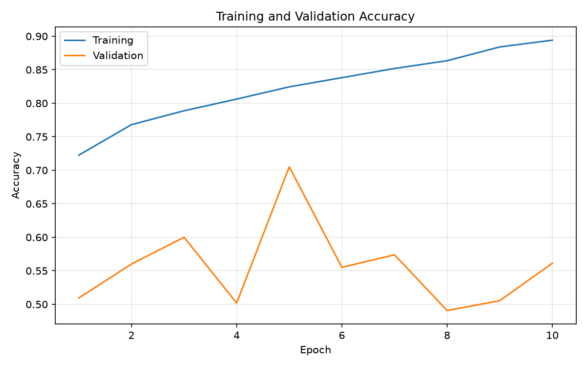

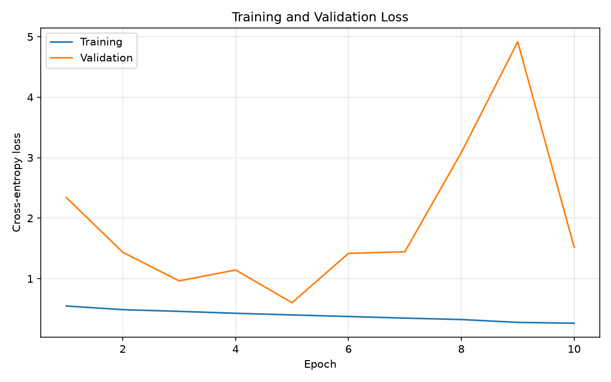

The baseline achieved its lowest validation loss at epoch 5, after which further training did not produce a sustained improvement in the checkpoint-selection criterion. Early stopping occurred at epoch 10.

### 5.2 ConvNeXt-Tiny

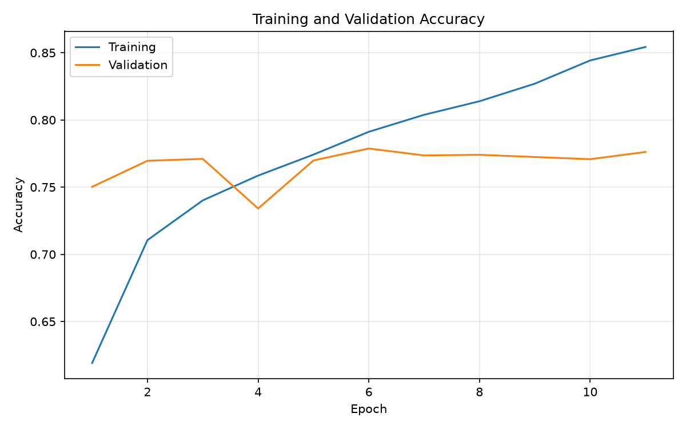

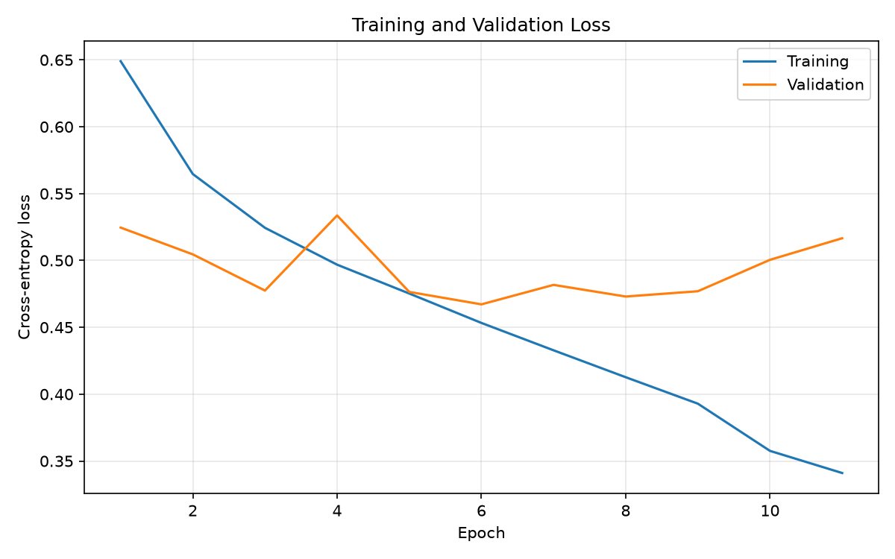

ConvNeXt reached its lowest validation loss at epoch 6 and stopped at epoch 11.

ConvNeXt achieved higher validation accuracy and lower validation loss than the baseline, although these improvements did not translate into a similarly large advantage in final patient-level test balanced accuracy.

## 6. Evaluation Methodology

### 6.1 Slice-level predictions

Each MRI slice is assigned a probability of belonging to the AD class.

Slice-level metrics are calculated using a classification threshold of 0.50.

### 6.2 Patient-level aggregation

Patient-level probabilities are calculated by averaging the predicted AD probabilities across all evaluated slices belonging to the same patient.

A classification threshold is then applied to the aggregated patient probability.

This approach reduces the evaluation to one prediction per patient rather than treating correlated slices as independent patients.

### 6.3 Validation-based threshold selection

Patient-level classification thresholds were selected using validation data only.

Thresholds between 0.05 and 0.95 were evaluated in increments of 0.01, with the threshold maximising validation patient-level balanced accuracy selected for each model. Ties were resolved in favour of the threshold closest to 0.50.

| Model | Selected threshold |
|---|---:|
| Baseline CNN | 0.78 |
| ConvNeXt-Tiny | 0.45 |

The selected thresholds were frozen before the held-out test evaluation.

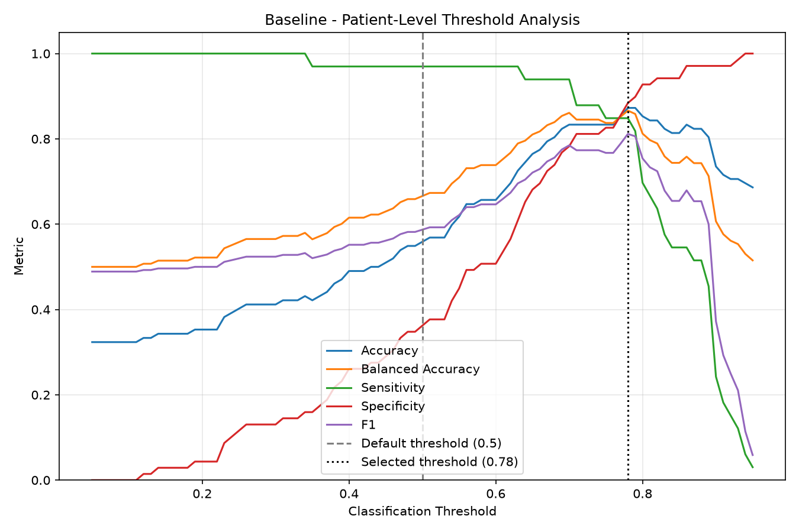

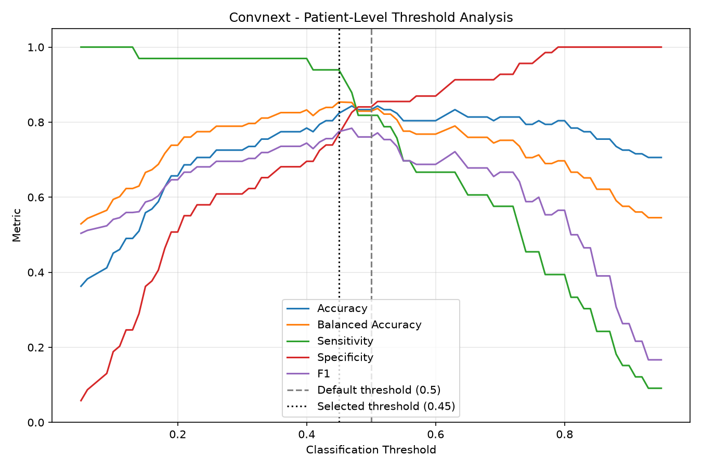

## 7. Experimental Results

### 7.1 Held-out test: slice-level classification

The independent test set contains 4,600 MRI slices from 102 patients.

| Metric | Baseline CNN | ConvNeXt-Tiny |
|---|---:|---:|
| Accuracy | 65.50% | **70.09%** |
| Balanced accuracy | 64.09% | **69.95%** |
| Sensitivity | **91.20%** | 72.64% |
| Specificity | 36.97% | **67.25%** |
| Precision | 61.63% | **71.12%** |
| F1 score | **73.55%** | 71.87% |
| AUROC | **0.7788** | 0.7628 |
| Brier score (lower is better) | 0.2275 | **0.2053** |

Both models used the default threshold of 0.50 for slice-level classification.

ConvNeXt achieved greater overall and balanced slice-level accuracy, whereas the baseline exhibited considerably higher sensitivity at the expense of specificity.

#### Slice-level confusion matrices

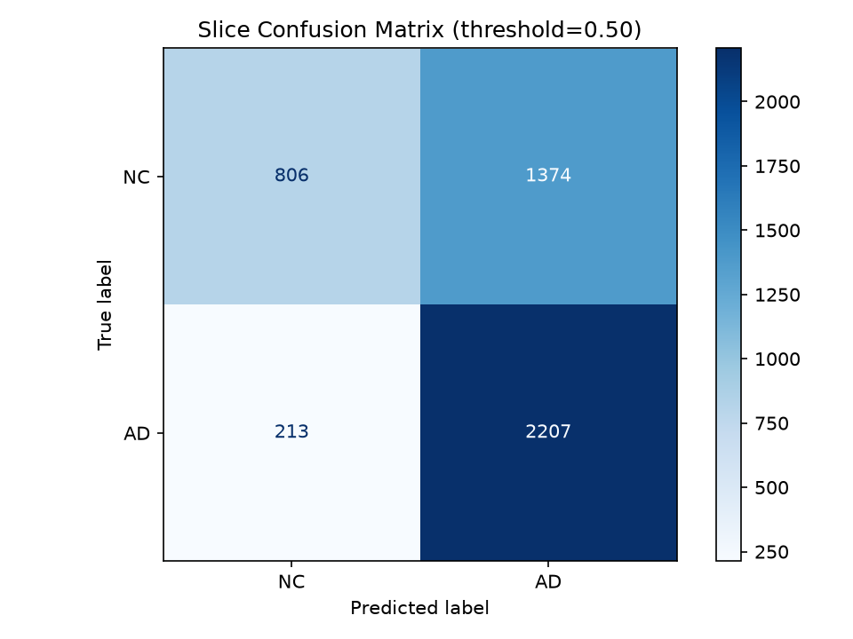

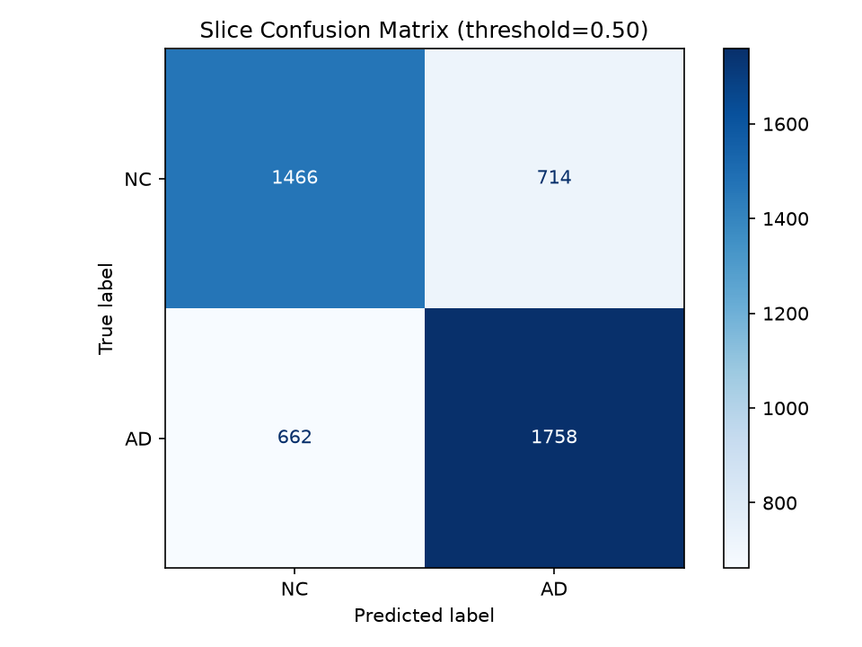

### 7.2 Held-out test: patient-level classification at threshold 0.50

| Metric | Baseline CNN | ConvNeXt-Tiny |
|---|---:|---:|
| Accuracy | 54.90% | **69.61%** |
| Balanced accuracy | 65.88% | **70.42%** |
| Sensitivity | **96.97%** | 72.73% |
| Specificity | 34.78% | **68.12%** |
| F1 score | 58.18% | **60.76%** |
| AUROC | **0.8186** | 0.8046 |
| Brier score | 0.2732 | **0.1778** |

At the default threshold, the baseline classified almost every AD patient correctly but incorrectly classified many NC patients as AD.

ConvNeXt demonstrated a more balanced sensitivity–specificity trade-off at the same threshold.

### 7.3 Held-out test: patient-level classification using validation-selected thresholds

This is the primary patient-level comparison.

| Metric | Baseline CNN | ConvNeXt-Tiny |
|---|---:|---:|
| Selected threshold | 0.78 | 0.45 |
| Accuracy | **74.51%** | 67.65% |
| Balanced accuracy | **70.88%** | 70.55% |
| Sensitivity | 60.61% | **78.79%** |
| Specificity | **81.16%** | 62.32% |
| Precision | **60.61%** | 50.00% |
| F1 score | 60.61% | **61.18%** |
| AUROC | **0.8186** | 0.8046 |
| Brier score | 0.2732 | **0.1778** |
| True negatives | **56** | 43 |
| False positives | **13** | 26 |
| False negatives | 13 | **7** |
| True positives | 20 | **26** |

The baseline achieved 70.88% balanced accuracy compared with 70.55% for ConvNeXt, a difference of approximately 0.33 percentage points.

Despite this similarity, the models exhibited different error distributions. The baseline correctly identified more NC patients, whereas ConvNeXt correctly detected more AD patients.

The difference in balanced accuracy is small and does not demonstrate statistically established superiority of either architecture.

#### Selected-threshold patient confusion matrices

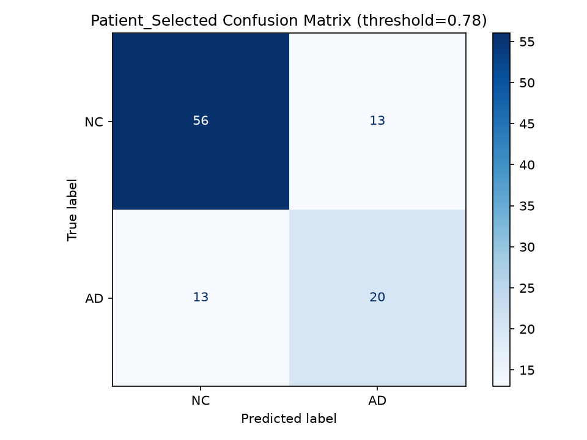

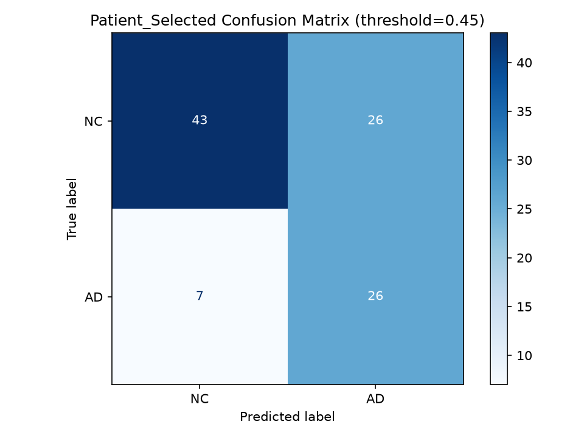

#### Patient-level ROC curves

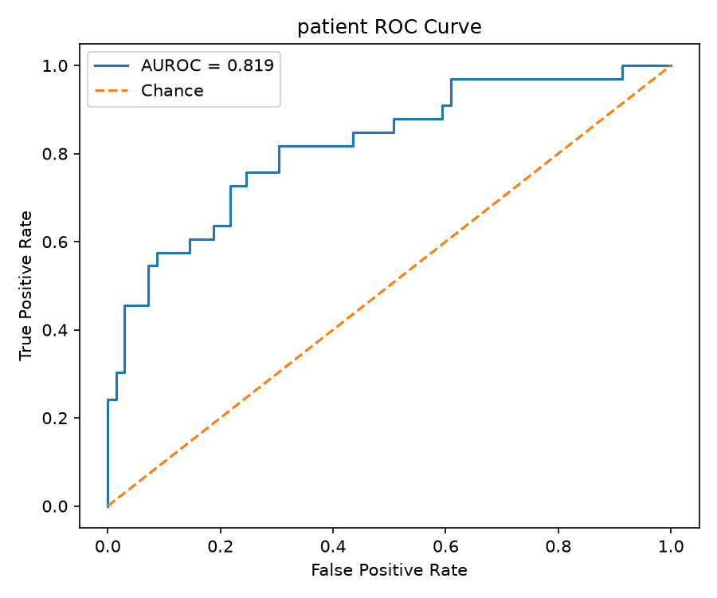

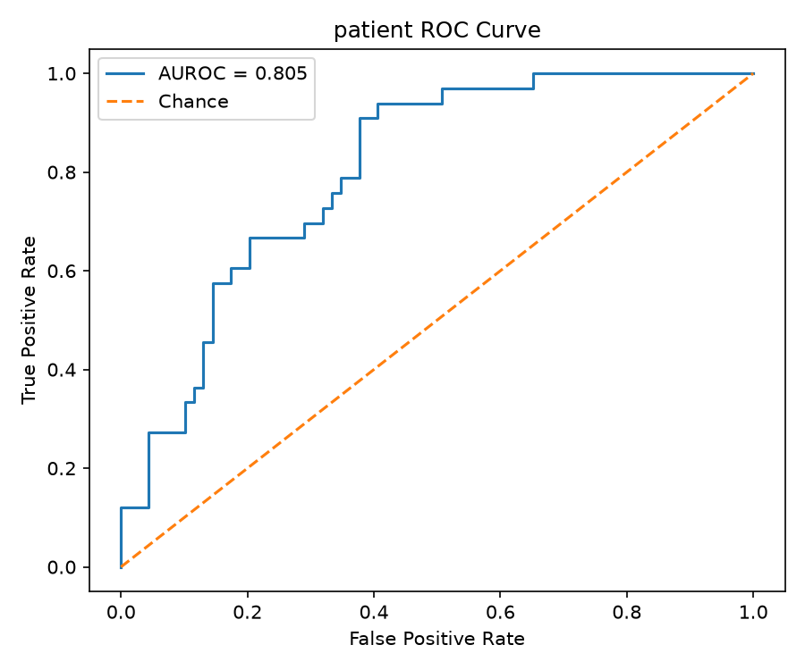

### 7.4 Validation-to-test generalisation

| Model | Validation balanced accuracy | Test balanced accuracy | Change |
|---|---:|---:|---:|
| Baseline CNN (0.78) | 86.63% | 70.88% | −15.74 pp |
| ConvNeXt-Tiny (0.45) | 85.38% | 70.55% | −14.82 pp |

Both models experienced substantial reductions in balanced accuracy between validation and testing.

These results demonstrate that preventing patient overlap does not guarantee strong generalisation to every unseen patient cohort.

Potential contributing factors include anatomical variability, cohort differences, overfitting and threshold-selection optimism. The present experiments do not isolate the contribution of each factor.

Because the validation set contains only 102 patients, the selected classification thresholds may also be sensitive to the specific patients included in that partition.

## 8. Prediction Confidence and Calibration

The Brier score measures the mean squared difference between predicted probabilities and binary ground-truth outcomes. Lower scores indicate more accurate probability predictions.

At the patient level:

- Baseline CNN: 0.2732
- ConvNeXt-Tiny: 0.1778

ConvNeXt produced substantially better patient-level Brier scores despite achieving similar patient-level AUROC and balanced accuracy.

This distinction is important: classification performance at a chosen threshold and probability quality are different properties.

Changing the classification threshold alters sensitivity, specificity and related decision metrics, but it does not change the probabilities themselves or their Brier score.

#### Calibration figures

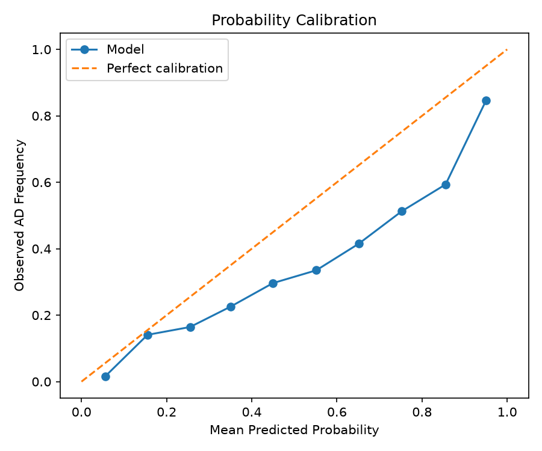

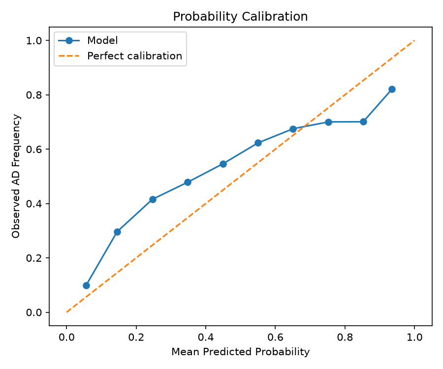

**Interpretation:** These results support the conclusion that ConvNeXt produces better probability predictions according to the measured Brier score. They do not establish that its probabilities are perfectly calibrated.

## 9. Computational Efficiency

| Resource | Baseline CNN | ConvNeXt-Tiny |
|---|---:|---:|
| Parameters | 1,173,730 | 27,821,666 |
| Training batch size | 32 | 16 |
| Peak allocated GPU memory | 1.02 GiB | 1.33 GiB |
| Approximate epoch duration | 94 s | 137 s |
| Measured test inference latency | 0.3262 ms/image | 1.5023 ms/image |

ConvNeXt contains approximately 23.7 times as many parameters as the baseline.

The baseline was faster under the tested inference configurations and required fewer parameters.

However, the inference batch sizes and training configurations were not identical. A controlled benchmark with matched batch sizes and repeated timing measurements would be necessary to quantify the architecture-specific performance difference precisely.

The results nevertheless illustrate that increasing model capacity does not necessarily deliver a proportionate improvement in held-out patient classification.

## 10. Qualitative Error Analysis

To investigate prediction reliability, representative false-positive and false-negative MRI slices were examined from the held-out test set. Three examples from each error category were generated for both architectures, with the analysis focusing on five illustrative cases.

### 10.1 High-confidence false positives

The baseline CNN incorrectly classified a cognitively normal (NC) MRI slice as Alzheimer's Disease (AD) with a predicted AD probability of 0.995. ConvNeXt-Tiny similarly produced a false positive with P(AD) = 0.959.

These examples demonstrate that both models can assign very high AD probabilities to images belonging to the NC class. High predicted confidence therefore does not guarantee classification correctness.

### 10.2 High-confidence false negatives

The baseline CNN incorrectly classified an AD slice as NC with P(AD) = 0.075. ConvNeXt-Tiny made a similarly confident false-negative prediction with P(AD) = 0.042.

An additional baseline false-negative example had P(AD) = 0.127, indicating another substantial discrepancy between the predicted probability and the true class.

These errors are especially relevant because the models did not merely produce ambiguous predictions near the decision threshold. They assigned probabilities strongly favouring the incorrect class.

### 10.3 Visual observations

The misclassified slices exhibit visible differences in anatomical coverage, image positioning, contrast and intensity. Such variability may complicate classification using individual two-dimensional MRI slices.

However, visual inspection alone cannot establish whether these factors caused the prediction errors. It is also not possible to reliably attribute individual predictions to specific neuroanatomical abnormalities without additional interpretability analysis and clinical assessment.

### 10.4 Implications for prediction confidence

The qualitative findings demonstrate that both architectures can produce highly confident incorrect predictions.

This supports evaluating probability quality separately from classification accuracy. Although ConvNeXt achieved a lower patient-level Brier score (0.1778) than the baseline CNN (0.2732), it still produced substantial errors on individual MRI slices.

The lower aggregate Brier score therefore does not imply that ConvNeXt is consistently reliable on every prediction.

These selected examples illustrate failure modes rather than their prevalence. Patient-level evaluation remains the primary measure of generalisation because multiple MRI slices may originate from the same subject.

Overall, the results support further investigation of probability calibration, uncertainty estimation and patient-level prediction aggregation before considering any practical medical application.

## 11. Discussion

### 11.1 Does ConvNeXt outperform the baseline?

ConvNeXt achieved higher slice-level accuracy, better patient-level probability prediction according to the Brier score, and higher patient sensitivity at its selected threshold.

However, it did not achieve a meaningful advantage in selected-threshold patient balanced accuracy on the held-out test cohort.

The baseline produced comparable balanced accuracy with substantially fewer parameters.

Consequently, the evidence does not support a general claim that the larger ConvNeXt architecture is superior across all evaluation criteria.

### 11.2 Why did validation results not generalise?

Both models experienced large validation-to-test performance decreases.

Although patient-independent splitting eliminated identified patient overlap between partitions, the models still needed to generalise across different patient characteristics.

Threshold optimisation may also have adapted to the validation cohort. The selected threshold should therefore be treated as an experimental configuration rather than a universally optimal operating point.

### 11.3 Reliability versus accuracy

The experiments highlight the distinction between:

- **Discrimination:** The ability to rank AD patients above NC patients, measured by AUROC.
- **Classification:** The accuracy and sensitivity–specificity trade-off at a particular threshold.
- **Probability quality:** How accurately predicted probabilities reflect observed outcomes, assessed here using the Brier score.

ConvNeXt's lower Brier score is a meaningful advantage even though its final balanced accuracy was similar to the baseline.

### 11.4 Study limitations

The primary limitations include:

1. A relatively small held-out patient cohort of 102 patients.
2. Training and evaluation on two-dimensional MRI slices rather than complete three-dimensional image volumes.
3. Threshold selection using a single validation cohort.
4. No independent external-dataset evaluation.
5. Uncontrolled differences in batch size between architecture benchmarks.
6. No formal statistical significance testing or patient-level confidence intervals.
7. Models trained from scratch, without assessing the potential contribution of pretrained representations.

The system is a coursework research experiment and is not validated for clinical diagnosis or deployment.

## 12. Engineering Recommendations

Based on the observed results, future work should prioritise:

**Patient-level validation:** Preserve patient-independent partitions and evaluate generalisation at the patient level.

**Probability calibration:** Explore calibration methods fitted exclusively on validation data and evaluate their performance on held-out patients.

**Threshold robustness:** Investigate how threshold choices vary across repeated patient-level splits or cross-validation folds.

**External validation:** Test on independent cohorts before drawing conclusions about wider generalisation.

**Controlled computational benchmarking:** Match batch sizes, hardware settings and timing procedures when comparing resource requirements.

**Clinical trade-off analysis:** If an intended use case is defined, choose operating thresholds according to its explicit false-negative and false-positive costs rather than balanced accuracy alone.

**Alternative architectures:** Investigate volumetric models, pretrained image encoders and multimodal approaches in future experiments.

## 13. Reproducibility

### 13.1 Project structure

```text
ConvNeXt_Edan/
├── dataset.py
├── modules.py
├── train.py
├── predict.py
├── threshold_analysis.py
├── compare_results.py
├── README.md
├── figures/
│   ├── baseline/
│   ├── convnext/
│   └── thresholds/
└── outputs/                 # Excluded from Git
```

The local `outputs/` directory contains checkpoints, evaluation metrics, predictions and generated figures. Some files contain patient-specific information and are not published.

### 13.2 Environment

Experiments used Python, PyTorch, torchvision, timm, scikit-learn and associated scientific Python packages.

**[To complete: provide exact tested package versions or a verified requirements file.]**

The dataset must be accessed from its authorised UQ Rangpur location.

### 13.3 Training

```bash
python train.py --model baseline --epochs 20 --batch-size 32 --lr 0.001

python train.py --model convnext --epochs 20 --batch-size 16 --lr 0.0001 --workers 1
```

### 13.4 Validation

```bash
python predict.py --checkpoint outputs/baseline/best_model.pth --split val --batch-size 32 --workers 1

python predict.py --checkpoint outputs/convnext/best_model.pth --split val --batch-size 16 --workers 1
```

### 13.5 Threshold analysis

```bash
python threshold_analysis.py
```

The validation-derived threshold file must be generated before reproducing selected-threshold test metrics.

### 13.6 Held-out test evaluation

```bash
python predict.py --checkpoint outputs/baseline/best_model.pth --split test --batch-size 32 --workers 1

python predict.py --checkpoint outputs/convnext/best_model.pth --split test --batch-size 16 --workers 1
```

### 13.7 Results comparison

```bash
python compare_results.py
```

**[To verify: exact command-line behaviour, dataset paths, threshold-file handling and installation instructions against the final source code.]**

## 14. Conclusion

This project compared a custom baseline CNN with ConvNeXt-Tiny for Alzheimer's Disease classification using patient-independent ADNI MRI partitions.

Although ConvNeXt achieved higher slice-level accuracy and better patient-level Brier scores, the two architectures achieved nearly identical held-out patient balanced accuracy after validation-based threshold selection: 70.88% for the baseline and 70.55% for ConvNeXt.

The baseline used approximately 23.7 times fewer parameters, but ConvNeXt detected more AD patients at the selected operating threshold.

The substantial validation-to-test performance decreases in both models emphasise the importance of independent patient-level evaluation, careful threshold selection and cautious interpretation of model confidence.

Overall, the findings demonstrate that greater architectural complexity does not automatically improve held-out classification performance and that accuracy, probability quality and computational efficiency should be assessed separately.

## 15. Artificial Intelligence Usage Disclosure

**[Review and personalise before submission.]**

ChatGPT was used to assist with planning the project, discussing implementation approaches, interpreting experimental results, debugging, and drafting or refining documentation.

AI-generated suggestions were reviewed and adapted during implementation. The experiments were executed on the UQ Rangpur computing cluster, and model performance was obtained from the resulting training and evaluation outputs.

The author remains responsible for the submitted code, experimental methodology, reported results and conclusions.

**[Add any other AI tools used, their specific contributions, and the verification steps actually performed, in accordance with the course requirements.]**
